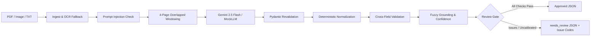

# Change Order Extraction

A pipeline for extracting structured financial and contractual fields from messy construction change orders (PDFs, plain text, and scans) into validated JSON with source text citations, deterministic validation, and uncertainty-aware review routing.

Construction change orders represent high-stakes legal amendments to prime contracts. This pipeline treats document text as untrusted claims rather than ground truth: it extracts printed figures verbatim without speculative arithmetic repair, verifies citations against source pages, and routes uncertain or inconsistent documents to human review.

---

## Key Capabilities

- **Multi-Format Ingestion:** Extracts digital text and tables from PDFs via PyMuPDF and pdfplumber, falling back to Tesseract OCR on image-only or low-density pages.
- **Structured LLM Extraction:** Extracts typed change orders using Google Gemini (`gemini-2.5-flash`) via the official `google-genai` SDK with constrained JSON schemas.
- **Evidence Grounding:** Validates that every non-null value has an exact or high-similarity (RapidFuzz $\ge 85\%$) verbatim source quote and valid page number.
- **Deterministic Validation:** Checks internal financial arithmetic (line-item sums, tax additions, revised contract totals) and date consistency using Python rules without LLM hallucinations.
- **Uncertainty & Review Gating:** Evaluates document reliability using DEV-fitted logistic calibration; routes 100% of ambiguous or arithmetic-mismatched files to human review (`needs_review: true`).
- **Offline Testability:** Includes a deterministic regex-based `MockLLM` fixture allowing full offline testing and CI validation without network dependencies or API keys.

---

## Architecture



The pipeline decouples the schema into two models:
1. `LLMOutput` (`src/co_extract/schema.py`): A minimal schema containing only `(value, evidence, page)` tuples, avoiding grammar complexity limits during constrained decoding.
2. `DocumentResult` (`src/co_extract/schema.py`): The internal domain model containing raw vs. normalized values, validation issue codes, match scores, review flags, and latency/token metadata.

---

## Quickstart

Requires Python **3.11+**. Tesseract OCR and Poppler are optional for digital PDFs and plain text; required for scanned image OCR.

### 1. Installation

**Linux / macOS:**
```bash
python3 -m venv .venv
source .venv/bin/activate
pip install -r requirements.txt
pip install -e . --no-deps
```

**Windows (PowerShell):**
```powershell
python -m venv .venv
.\.venv\Scripts\Activate.ps1
pip install -r requirements.txt
pip install -e . --no-deps
```

### 2. Run Offline Tests
```bash
pytest -q
```
Runs all 72 regression, unit, and property tests in ~18 seconds without network calls.

### 3. Extract a Sample Document (Offline Mode)
```bash
python -m co_extract extract examples/sample.pdf --mock --out out/
```
Extracts `examples/sample.pdf` using the heuristic mock and writes validated JSON to `out/sample.json`.

### 4. Run with Live Gemini (Optional)
Create a `.env` file with your Gemini API key:
```env
GEMINI_API_KEY=your_gemini_api_key_here
EXTRACTION_MODEL=gemini-2.5-flash
```

Verify live connectivity with a single primary smoke test:
```bash
python -m co_extract smoke
```

Extract a document uncached using live Gemini:
```bash
python -m co_extract extract examples/sample.pdf --out out/ --no-cache
```

---

## Example Input and Output

**Input (`examples/sample.pdf` excerpt):**
```text
Change Order Number: CO-0124
Project Name: Harbor Library Expansion
Project Number: P-2123
Contract Number: CT-223
Date Issued: 2026-08-17
Subtotal: $2,300.00
Total Amount: $2,300.00
Original Contract Sum: $100,000.00
Revised Contract Sum: $102,300.00
```

**Output JSON (`out/sample.json` excerpt):**
```json
{
  "orders": [
    {
      "change_order_number": {
        "value": "CO-0124",
        "normalized_value": "CO-0124",
        "confidence": 0.9367,
        "evidence": "Change Order Number: CO-0124",
        "page": 1,
        "flags": []
      },
      "total_amount": {
        "value": 2300.0,
        "normalized_value": 2300.0,
        "confidence": 0.9367,
        "evidence": "Total Amount: $2,300.00",
        "page": 1,
        "flags": []
      },
      "revised_contract_sum": {
        "value": 102300.0,
        "normalized_value": 102300.0,
        "confidence": 0.9367,
        "evidence": "Revised Contract Sum: $102,300.00",
        "page": 1,
        "flags": []
      }
    }
  ],
  "document_confidence": 0.9367,
  "needs_review": true,
  "validation_report": []
}
```
*Full outputs for clean, scanned, and conflicting arithmetic cases are available in [`examples/`](examples/).*

---

## Evaluation Summary

All reported numbers are strictly separated by dataset and extraction engine:

| Evaluation Split | Evaluated Model | Documents (Fields) | Field F1 | Line-Item F1 | Latency (Mean / p50) | Review Routing |
|---|---|:---:|:---:|:---:|:---:|:---:|
| **Live Gemini DEV** | **Gemini 2.5 Flash** (Live API) | 11 (325 fields) | **0.9966** | **1.0000** | 10.1s / 9.0s | 11 / 11 Review |
| **Synthetic TEST** | Offline MockLLM Heuristic | 40 (1,180 fields) | **0.9952** | **0.9783** | 22.5 ms / 22 ms | 40 / 40 Review |
| **Adversarial Challenge** | Offline MockLLM Heuristic | 26 (768 fields) | **0.7902** | **0.0000** | 18.4 ms / 18 ms | 26 / 26 Review |

### Evaluation Takeaways:
1. **Live Gemini Accuracy:** On 11 synthetic DEV documents (including two multi-order documents), Gemini 2.5 Flash extracted 325 fields with 291 true positives, 1 false positive, 1 false negative, 0 hallucinations, and 100% correct null handling. The single failure was an OCR scan artifact where `project_number` read `P~2060` instead of `P-2060`.
2. **The Synthetic Gap:** The offline regex baseline achieves 0.9952 F1 on synthetic templates, but collapses to **0.7902 F1** (and 0.0000 on complex tables) when evaluated against the independent **26-case Adversarial Challenge Dataset** (`data/challenge/`).
3. **Selective Review Gating:** The calibrator on DEV sets the auto-accept threshold to **1.01**, routing 100% of documents to review. This is an intentional safety posture: documents with arithmetic mismatches or ambiguous dates receive similar text-grounding scores to clean documents, making automated financial approval unsafe without human verification.

---

## Limitations

- **Provider Quota:** Live Gemini evaluation is subject to Google AI Studio's Free Tier quota of 20 requests per day per project. Uncached challenge cases were not evaluated live due to quota exhaustion (`429 RESOURCE_EXHAUSTED`).
- **Synthetic-to-Real Shift:** Metrics from synthetic generators reflect template regularity. Real-world handwritten carbon copies and non-standard subcontractor spreadsheets require human review.
- **Conservative Gating:** The prototype defaults to `needs_review: true` for all documents to prevent false automated financial approvals.
- **Environment Checks:** `mypy` static typing and Docker container builds were not fully executed in the local evaluation environment.

---

## Repository Layout

```text
change-order-extraction/
├── README.md               # Quickstart and system overview
├── WRITEUP.md              # Technical writeup and failure modes analysis
├── requirements.txt        # Pinned Python dependencies
├── pyproject.toml          # Build configuration and tool settings
├── Makefile                # Standard developer targets
├── Dockerfile              # Container specification with OCR tools
├── .env.example            # Environment variable template
├── src/co_extract/         # Pipeline package
│   ├── cli.py              # CLI entrypoints (extract, eval, smoke, schema)
│   ├── config.py           # Settings and environment loader
│   ├── schema.py           # Pydantic LLM and domain models
│   ├── ingest.py           # Multi-format ingestion and OCR fallback
│   ├── llm.py              # Gemini client, MockLLM, and caching
│   ├── extract.py          # Windowing, order merge, and bounded repair
│   ├── normalize.py        # Date, number, and currency normalizers
│   ├── validate.py         # Deterministic business logic checks
│   ├── confidence.py       # RapidFuzz grounding and logistic calibrator
│   └── security.py         # Prompt injection detection and PII logging
├── tests/                  # Pytest test suite (72 tests)
├── data/
│   ├── synthetic/          # 120 synthetic train/dev/test documents
│   ├── handwritten_samples/# 10 text memos
│   └── challenge/          # 26 independent adversarial challenge cases
├── eval/                   # Evaluation runners, metrics, and frozen results
└── examples/               # Representative demonstration inputs and outputs
```

---

## Additional Documentation

- [`WRITEUP.md`](WRITEUP.md): In-depth discussion of engineering approach, design trade-offs, quantitative results, concrete failure modes, and production roadmap.
- [`docs/schema.json`](docs/schema.json): Machine-readable JSON Schema for the internal `DocumentResult` domain model.
