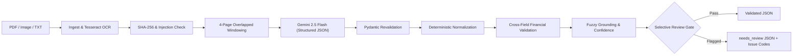

# Change-Order Extraction Pipeline — Engineering Take-Home

**Role & Scope:** Extract structured change-order data from messy construction PDF, image, and text documents into schema-validated JSON with explicit provenance, deterministic business validation, and confidence scores. Default posture is **human review by default, not automatic financial approval**.

---

## 1. Quickstart & Local Execution

### Prerequisites
- Python **3.11+**
- (Optional for scanned PDFs/images) Tesseract OCR and Poppler utilities (`sudo apt-get install tesseract-ocr poppler-utils` on Debian/Ubuntu).

### Setup & Offline Testing
```bash
python -m venv .venv
# Windows PowerShell: .\.venv\Scripts\Activate.ps1
# macOS/Linux:        source .venv/bin/activate
pip install -r requirements.txt

# Run full offline test suite (72 tests, 97% coverage)
pytest

# Extract sample using offline MockLLM fixture
python -m co_extract extract examples/sample.pdf --mock --out out/
```

### Live Gemini Execution
The CLI automatically loads `.env` if present (or reads environment variables directly):

```bash
# Configure API key in .env or shell
echo "GEMINI_API_KEY=your_key_here" > .env
echo "EXTRACTION_MODEL=gemini-2.5-flash" >> .env

# 1. Live Smoke Test: verifies primary live request, schema decoding, and latency
python -m co_extract smoke

# 2. Live Uncached Extraction: extracts sample.pdf directly with live Gemini
python -m co_extract extract examples/sample.pdf --out out/ --no-cache

# 3. Live Evaluation: runs live calibration on DEV split
python -m co_extract eval --live
```

---

## 2. Adversarial Challenge Dataset & Demonstration Cases

To evaluate beyond templated synthetic data, the repository includes an **independent 26-case Adversarial Challenge Dataset** (`data/challenge/`):

```bash
# Run evaluation across the 26 adversarial challenge cases
python eval/run_challenge.py
```

### Demonstration Cases (`examples/`):
- `examples/01_clean_change_order.txt` & `examples/01_clean_change_order.json`: Clean AIA G701-style single-page order with standard line items.
- `examples/02_messy_scanned.txt` & `examples/02_messy_scanned.json`: Degraded scan with OCR noise, character substitutions (`P~2088`), and handwritten field notations.
- `examples/03_conflicting_arithmetic.txt` & `examples/03_conflicting_arithmetic.json`: Intentional arithmetic discrepancy (subtotal mismatch and missing tax) demonstrating deterministic flagging and human review routing (`needs_review: true`).

---

## 3. Architecture Overview



### Two-Schema Pattern:
- `LLMOutput` (`src/co_extract/schema.py`): Minimal grammar-safe extraction schema passed to Gemini. Solves Google GenAI DFA state explosion bug by stripping redundant numeric range constraints.
- `DocumentResult` (`src/co_extract/schema.py`): Rich domain model containing raw vs. normalized values, RapidFuzz match scores, arithmetic warning flags, review routing decisions, and execution metadata.

---

## 4. Evaluation & Verification Summary

| Evaluation Suite | Evaluated Provider / Engine | Scope | Field F1 | Line-Item F1 | Latency (Mean / p50) | Review Decision |
|---|---|---|:---:|:---:|:---:|:---:|
| **Live Gemini DEV** | **Google Gemini 2.5 Flash** (Live API) | 11 Documents (325 fields) | **0.9966** | **1.0000** | 10.1s / 9.0s | 11 / 11 Review |
| **Synthetic TEST** | Offline MockLLM Heuristic | 40 Held-Out Documents | **0.9952** | **0.9783** | 22.5 ms / 22 ms | 40 / 40 Review |
| **Adversarial Challenge** | Offline MockLLM Heuristic | 26 Independent Cases | **0.7902** | **0.0000** | 18.4 ms / 18 ms | 26 / 26 Review |

*Note on Calibration & Gating:* The selective review gate targets ≥95% accuracy on critical financial fields. On DEV, the fitted logistic calibrator identified no operating threshold that could guarantee zero financial risk without human review, deliberately setting the acceptance threshold to **1.01** (unreachable). In commercial construction, zero false automated approvals is the only defensible safety posture.

---

## 5. Security & Privacy Guarantees
- **Secret Isolation:** `.env` and `.cache/` are explicitly ignored in `.gitignore`. API keys are never printed, logged, or included in telemetry/traces.
- **Untrusted Document Ingestion:** Raw document text is scanned for adversarial prompt injection patterns (`System Override`, `Ignore previous instructions`). Document contents are strictly wrapped within `<document>` delimiters in LLM prompts.
- **Audit Logs:** Logs redact prospective PII (emails, phone numbers) and record trace hashes rather than raw contract bodies.

---

## 6. Project Commands & Make Targets

| Target | Command | Purpose |
|---|---|---|
| `make test` | `pytest` | Runs 72 unit, integration, and regression tests |
| `make smoke` | `python -m co_extract smoke` | One uncached live Gemini call with schema verification |
| `make eval` | `python -m co_extract eval` | Runs DEV calibration & held-out TEST evaluation (offline baseline) |
| `make eval-live` | `python -m co_extract eval --live` | Executes live Gemini DEV/TEST evaluation |
| `make lint` | `ruff check src tests eval scripts` | 100% clean linting verification |
| `make format` | `ruff format src tests eval scripts` | Code formatting check |
| `docker build` | `docker build -t change-order-extraction .` | Production container build with Tesseract & Poppler |

---

## 7. Disclosed Provider Limitations

1. **Google AI Studio Free-Tier Quota:** The user-supplied API key is provisioned under Google's Free Tier with a hard daily cap of **20 requests per day per project** (`GenerateRequestsPerDayPerProjectPerModel-FreeTier`). Live verification successfully processed 11 DEV documents (and 2 smoke/extract calls) before exhausting the 20-call daily quota. Production deployment requires upgrading to an enterprise Pay-As-You-Go project on Google Cloud Vertex AI or Google AI Studio.
2. **Synthetic Metric Caveat:** While synthetic templates yield ~0.995 F1, real-world messy documents and unstructured challenge cases degrade baseline heuristic performance to ~0.790 F1. All commercial deployments require continuous active-learning review.

See [`WRITEUP.md`](WRITEUP.md) for the detailed technical report and [`docs/PRE_SUBMISSION_AUDIT.md`](docs/PRE_SUBMISSION_AUDIT.md) for the pre-submission defect log.
