# Change-order extraction — engineering take-home

**Scope:** Read messy construction change-order PDF/text/image documents and emit schema-validated, provenance-bearing JSON with explicit uncertainty. Default posture is **human review, not automatic financial approval**. This is a reproducible engineering demonstration, **not a benchmark of Gemini accuracy on real contracts**.

## Five-minute quickstart

Requirements: Python **3.11+** (CI uses 3.11). Tesseract/Poppler are optional for PDF text-only tests; image/scanned documents need Tesseract. To install optional OCR on Ubuntu: `sudo apt-get install tesseract-ocr poppler-utils`. On Windows, install Tesseract OCR and Poppler separately and add them to `PATH` (or run the Docker image).

```bash
python -m venv .venv
# Windows PowerShell: .\.venv\Scripts\Activate.ps1
# macOS/Linux: source .venv/bin/activate
make setup
make data
make test
python -m co_extract extract examples/sample.pdf --mock --out out/
make eval
```

Without the API key, the CLI **explicitly labels its fallback as a rule-based MockLLM**. The mock is a development fixture, not an LLM. `out/sample.json` contains one fully typed extraction with per-field evidence/page/confidence and `needs_review`. To reproduce the original spec's sample command, run `python -m co_extract extract examples/sample.pdf` (it uses Gemini if an API key is present, otherwise explicitly warns and uses the mock).

### Live Gemini (requires user-provided API key)

```bash
cp .env.example .env  # Windows: copy .env.example .env
# Set GEMINI_API_KEY in your shell (the CLI does not auto-load .env).
# Set EXTRACTION_MODEL=gemini-3.8-flash after verifying the model name in Google AI Studio.
make smoke             # ONE non-cached primary live Gemini request; prints validated JSON
python -m co_extract extract examples/sample.pdf --out out/ --no-cache
make eval-live         # real DEV calibration + TEST evaluation; incurs API calls
```

**Check live model availability before running.** The default `gemini-3.8-flash` was checked against [Google's model listing](https://ai.google.dev/gemini-api/docs/models) on 2026-10-23, but provider versions can disappear or have account-specific availability. `EXTRACTION_MODEL` is always passed to the SDK rather than hardcoded in a model invocation. The `google-genai` SDK is required; the obsolete `google-generativeai` package is not used. A 404 produces an actionable error. Missing key for `make smoke` is an intentional exit code 2, **not** a successful smoke result.

**Privacy:** Never transmit real owner/contractor details to the Gemini API for this assignment. Some Gemini API free-tier usage may be used to improve provider products; review the [official provider terms and pricing tables](https://ai.google.dev/gemini-api/docs/pricing) and use only invented/non-sensitive records. Logs contain trace metadata, not raw document bodies; caches may contain snippets/evidence and should be protected accordingly. `.env` is excluded from Git.

## Architecture

```mermaid
flowchart LR
  A[PDF / TXT / JPG / PNG] --> B[Per-page text/tables + OCR fallback]
  B --> C[SHA-256 + flagged unsafe document instructions]
  C --> D[Page-window extraction with overlap]
  D --> E[Gemini structured JSON or offline heuristic mock]
  E --> F[Pydantic revalidation + bounded repair]
  F --> G[Merge orders / preserve conflicts]
  G --> H[Raw values + separate normalization]
  H --> I[Deterministic financial, date, enum validation]
  I --> J[Evidence grounding + DEV-fitted confidence]
  J --> K{Review gate}
  K -->|all checks pass| L[Validated JSON]
  K -->|otherwise| M[needs_review JSON + reason codes]
```



Two schemas intentionally coexist: `LLMOutput` has concrete wrappers (`StrField`, `FloatField`, `IntField`, `DateField`, `EnumField`) that accept minimal JSON, while `DocumentResult` adds normalizations, validator issues, review flags, token accounting and evidence. `docs/schema.json` is the **internal output schema**, not the SDK's model-facing schema.

## Commands and components

| Command | Behavior |
|---|---|
| `python -m co_extract extract <file-or-dir> --out out/ [--mock] [--no-cache] [--self-consistency 3] [--vision]` | Extract documents, isolate failures, honor bounded concurrency |
| `python -m co_extract schema` | Rebuild public internal JSON Schema |
| `python -m co_extract generate-data` | Regenerate deterministic 120-document corpus plus 10 rough memo samples |
| `python -m co_extract eval [--live]` | DEV calibration and held-out TEST evaluation |
| `make lint`, `make typecheck`, `make test` | Ruff, mypy and offline test suite |
| `docker build -t change-order . && docker run --rm change-order --help` | Container CLI with Tesseract/Poppler installed |

Source components are under `src/co_extract/`: `ingest.py` for documents; `schema.py` for typed contracts; `prompts.py` for versioned instructions; `llm.py` for Google SDK/rate limiting/retries/cache and a heuristic mock; `extract.py` for chunking/merge/repair; `normalize.py` and `validate.py` for deterministic checks; `confidence.py` for grounding and calibration; `security.py` for review hints/log redaction; `pipeline.py` for failure isolation; `cli.py` for commands. `eval/` contains the independent runner, matching rules, regex baseline and frozen output artifacts.

### Calibration and what the numbers actually mean

The generator makes **60 train**, **20 DEV** and **40 held-out TEST** synthetic documents from a fixed seed. The scorer fits only on DEV; it chooses an auto-accept threshold on DEV with a minimum *target* of 95% observed critical-field correctness; if no threshold is justified, it deliberately **accepts none** (`1.01`). The TEST split is never used in fitting or threshold selection. Calibration parameters are model-specific: DEV parameters fitted on `mock-regex-v1` cannot be applied to Gemini.

Current committed **offline heuristic test** (actual local run, not Gemini):

| TEST measure | Result |
|---|---:|
| Field precision / recall / F1 | 0.9971 / 0.9932 / 0.9952 |
| Matched line-item F1 | 0.9783 |
| Expected calibration error, extracted non-null fields | 0.1604 |
| Documents marked `needs_review` | 40 / 40 |
| Tested live Gemini calls | **0 (pending key/provider SDK setup)** |

These values are **inflated by synthetic template regularity**. The offline `MockLLM` is implemented using the **same heuristic extraction logic as the regex baseline**, so its measured difference from the baseline is **zero by design**. Do not use its F1 or confidence to make a Gemini or real-world performance claim. Review [the full per-tag report](eval/results/report.md), [raw mistakes](eval/results/raw.json), [summary](eval/results/summary.json), and [reliability plot](eval/results/reliability.png). Rerun with `make eval` after changes; live results are pending a key and do not magically appear with the mock.

### Cost, caching and caveats

Gemini requests have a configurable token bucket (`CO_REQUESTS_PER_MIN`, default 20), limited batch concurrency (`CO_CONCURRENCY=2`), exponential backoff with jitter on transient provider errors, and a disk cache hashed over source, prompt/model, temperature, request content and vision mode. Token usage from SDK metadata is stored per result. `CO_INPUT_USD_PER_M` / `CO_OUTPUT_USD_PER_M` are **illustrative placeholders**, not a pricing claim. Only source SHA-256 and model configuration, not the API key, enter the cache key. Force a fresh call using `--no-cache`.

A quote can be present in a document and still misidentify the right field. OCR often changes dashes and numbers; fuzzy matching is only a **grounding hint**. Arithmetic checks **never correct** reported totals. Date ambiguity forces `normalized_value=null`. Security scanning is a review heuristic and does not make documents trusted. A failing input or blocked provider response becomes a typed review result, not a batch crash. Re-run evaluation on *independently annotated real contracts* before any production use.

## Limitations of this checked-in run

Live Gemini output contracts, structured-schema compatibility, API rate limits and model-specific reliability were **not tested** in the offline build environment (no `GEMINI_API_KEY`; package repository inaccessible). The PyPI pinned dependencies are a specification for a connected developer workstation/CI, not proof they were all installed on this machine. Automated Ruff and mypy runs are pending successful dependency installation, although Python compilation and all currently executed offline tests pass. See [WRITEUP.md](WRITEUP.md) for observed error examples and [REVIEW_CHECKLIST.md](REVIEW_CHECKLIST.md) for exact status.
