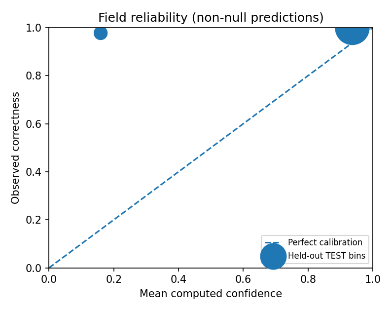

# Reproducible held-out TEST evaluation

**Mode:** `mock-regex-v1`
**Prompt version:** `co-extract-2026-10-v1`
**Counts:** 60 training (not used in fit), 20 DEV (calibration only), 40 held-out TEST.

> **Interpretation:** MockLLM is a regex heuristic test double, not Gemini. Its scores must not be sold as LLM model accuracy or predictive calibration. The baseline uses the SAME heuristic, so equal numbers are expected.

| Test metric | Mock/actual selected model | Regex baseline |
|---|---:|---:|
| Field precision | 0.9971 | 0.9971 |
| Field recall | 0.9932 | 0.9932 |
| Field F1 | 0.9952 | 0.9952 |
| Correct null rate | 1.0 | 1.0 |
| Hallucination rate | 0.0 | 0.0 |
| Line item matched F1 | 0.9565 | not computed separately |

**ECE on extracted non-null TEST fields:** 0.1604 (10 fixed bins).
**Documents marked for review:** 40/40.
**Latency p50/p95:** 24/777 ms; **cost estimate:** $0.000000 (assumed prices, not invoices).

## Hard-case slices (actual TEST)

| Tag | N field rows | F1 |
|---|---:|---:|
| ambiguous_date | 75 | 1.0000 |
| distractor_numbers | 75 | 0.9855 |
| european_numbers | 100 | 0.9891 |
| missing_fields | 75 | 1.0000 |
| negative_credit | 100 | 1.0000 |
| negative_minus | 100 | 1.0000 |
| negative_parentheses | 100 | 1.0000 |
| non_summing | 100 | 1.0000 |
| ocr_typos | 75 | 0.9778 |
| pii | 100 | 0.9891 |
| prompt_injection | 75 | 0.9927 |
| superseded_revision | 100 | 1.0000 |
| tbd | 75 | 1.0000 |

## Format slices

| Format | N field rows | F1 |
|---|---:|---:|
| aia_style_pdf | 125 | 0.9955 |
| email_text | 125 | 0.9954 |
| multi_page_pdf | 150 | 0.9963 |
| pasted_txt | 150 | 1.0000 |
| scanned_pdf | 150 | 0.9738 |
| two_orders_pdf | 300 | 1.0000 |
| typed_pdf | 150 | 1.0000 |

## Threshold and ablations

DEV-fitted: `True`; threshold `1.01`; DEV training rows `519`.
Calibration is conditional on a non-null extraction, and may be poorly identified in this tiny synthetic DEV set. A target DEV selective precision is not a real-world guarantee.

Mock-only ablations: validation retry, self-consistency (temperature 0.5), and vision-vs-text are **not independently measurable** because MockLLM ignores temperature and the PDF bytes and emits already schema-valid JSON. Turning them on would yield artificial null differences, so no gain is reported.
Grounding check ablation changes confidence/review flags but not extracted field F1. For a real comparison run the live model and write independent raw outputs before calculating deltas.

### Auto-accept field coverage vs selective error

| Confidence threshold | Coverage | Error among accepted |
|---:|---:|---:|
| 0.00 | 1.0000 | 0.0029 |
| 0.20 | 0.8712 | 0.0000 |
| 0.40 | 0.8712 | 0.0000 |
| 0.60 | 0.8712 | 0.0000 |
| 0.80 | 0.8712 | 0.0000 |
| 0.90 | 0.8712 | 0.0000 |
| 0.95 | 0.0000 | N/A |
| 1.00 | 0.0000 | N/A |

## Evaluation limitations

- All labeled samples are generated by one template family. This is not an estimate of real construction documentation performance.
- Synthetic references describe explicit fields; omitted/ambiguous fields are intentional. Documents and truth are synthetic.
- No production PDF distribution, annotated handwriting, provider response, real-rate-limit, or provider privacy test is available without external credentials and real labeled documents.
- Numeric cost estimates depend on configurable assumptions and reported token metadata.
- `raw.json` lists document IDs, failures and severity codes for reproducible error analysis.
